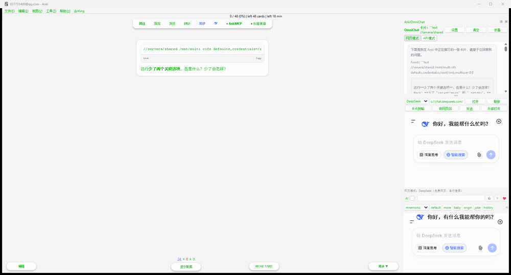

# AnkiOmniChat

在 Anki 内复刻 Obsidian OmniChat 的侧边 AI 对话体验：右侧常驻可停靠/可折叠的聊天面板，
以「单张卡片（Note）」为文档上下文，Note ID 作为会话 key，不同卡片的聊天历史相互隔离。

- 兼容版本：Anki **2.1.60 ~ 2.1.66**，并已在 **Anki 25.x / 26.x（PyQt6 / Python 3.13）** 上做适配验证
- **AnkiWeb：[ankiweb.net/shared/info/1939948095](https://ankiweb.net/shared/info/1939948095)**（Add-on ID `1939948095`）
- 技术约束：只用官方 Qt WebEngine、`anki` / `aqt` hooks 与 Anki 自带库；**零第三方 pip 依赖**
- 双后端：**模式 A（默认）WebView 内嵌免费网页** / **模式 B OpenAI 兼容 API（流式）**
- Qt 适配：PyQt5 与 PyQt6 的枚举差异（作用域/非作用域）统一由 `qt_compat.py` 处理

---

## 0. 演示



复习中翻到答案面 → 侧边栏自动切到这张卡的会话并把卡片全部字段注入 → 一键写入网页输入框提问。

---

## 1. 功能一览

| 能力 | 说明 |
|---|---|
| 侧边面板 | 右侧 `QDockWidget`，可停靠/浮动/折叠；复习界面与浏览界面（Browse）都可启用，同一实例在两个窗口间迁移 |
| 会话隔离 | 会话 key = `note:<Note ID>`；切换卡片自动切换会话（可关闭）；无卡片时为「自由会话」 |
| 卡片注入 | 快捷键一键注入当前卡片全部字段；翻卡（显示答案）自动注入；字段可排除、可自定义模板 |
| 模式 A 网页 | 内置豆包 / Kimi / DeepSeek 入口，用户在面板内自行登录，cookie 本地持久化；一键把卡片文本写入网页输入框，**默认不自动发送** |
| 模式 B API | OpenAI 兼容 `/v1/chat/completions`，SSE 流式逐字输出，工作线程请求不卡界面，可随时「停止」 |
| 渲染 | 自研极简 Markdown 渲染器 + 复用 Anki 自带 MathJax 渲染 `$...$` / `$$...$$` |
| 动作按钮 | 每条 AI 消息下方：追加到卡片字段 / 覆盖卡片字段 / 复制文本 |
| 持久化 | 会话历史写入本地 JSON（原子写 + 损坏自动备份），重启 Anki 不丢失 |

---

## 2. 安装步骤

### 方式一：AnkiWeb 安装（最省事）

1. Anki → 工具 → 插件 → 「获取插件…」
2. 粘贴 Add-on ID：**`1939948095`**，回车，重启 Anki。

也可直接打开 <https://ankiweb.net/shared/info/1939948095> 查看页面与下载。

### 方式二：文件夹安装（推荐，便于改代码）

1. 关闭 Anki。
2. 找到插件目录：
   - Windows：`%APPDATA%\Anki2\addons21`
   - macOS：`~/Library/Application Support/Anki2/addons21`
   - Linux：`~/.local/share/Anki2/addons21`
3. 把整个 `AnkiOmniChat` 文件夹复制进去，得到：

   ```
   addons21/
     └── AnkiOmniChat/
           ├── __init__.py
           ├── meta.json
           ├── config.json
           ├── config.py
           ├── session_manager.py
           ├── backend.py
           ├── anki_hook.py
           └── ui/
   ```

4. 启动 Anki。首次加载会自动在 `addons21/AnkiOmniChat/` 下生成默认配置；主窗口右侧出现
   「AnkiOmniChat」面板（也可在 工具 → AnkiOmniChat：显示/隐藏侧边栏 打开）。

### 方式三：GitHub 仓库安装

```bash
git clone https://github.com/safeblood/AnkiOmniChat.git
cp -r AnkiOmniChat/AnkiOmniChat <addons21 目录>/
```

或直接从 Releases 页下载打好包的 `AnkiOmniChat.ankiaddon`。

### 方式四：打包安装

1. 把 `AnkiOmniChat` 文件夹压缩为 zip（注意：**zip 根目录内直接是文件，不要再套一层文件夹**）。
2. 重命名为 `AnkiOmniChat.ankiaddon`。
3. Anki → 工具 → 插件 → 安装插件文件，选择该文件，重启 Anki。

> 卸载：工具 → 插件 → 选中 AnkiOmniChat → 删除；再手动删除 profile 目录下的
> `Anki2/<用户名>/AnkiOmniChat/`（会话历史）。

---

## 3. 目录结构

```
AnkiOmniChat/
├── __init__.py            入口：注册 profile_did_open / profile_will_close
├── config.py              配置中心：默认值、点号路径读写、数据目录
├── session_manager.py     会话持久化：JSON 原子写、按 Note ID 隔离
├── backend.py             双后端：WebBackend（注入/抓取脚本）+ ApiBackend（SSE 流式线程）
├── qt_compat.py           Qt5(PyQt5)/Qt6(PyQt6) 枚举与 WebEngine 导入统一适配
├── anki_hook.py           集成层：Dock 停靠、hooks、快捷键、菜单、动作分发
└── ui/
    ├── markdown.py        极简 Markdown → HTML（含 LaTeX 抽取）
    ├── latex.py           定位/复用 Anki 自带 MathJax，失败降级 CDN
    ├── chat_page.py       生成消息页 HTML（OmniChat 风格 CSS + JS 接口）
    ├── chat_view.py       QWebEngineView 封装：渲染、流式、ankiomni:// 动作回调
    ├── web_panel.py       模式 A 的网页视图（独立持久化 profile）
    ├── panel.py           面板主体：标题栏 / 模式切换 / 输入区 / 状态栏
    ├── actions.py         追加 / 覆盖卡片字段、复制、卡片文本拼装
    └── settings.py        设置对话框（六个分组）
```

---

## 4. 配置说明（工具 → AnkiOmniChat：设置）

### 通用
| 项 | 默认 | 说明 |
|---|---|---|
| 默认后端模式 | 网页模式 | `web` = 内置浏览器免费模式；`api` = OpenAI 兼容接口 |
| 切换卡片时自动切换会话 | 开 | 关闭后所有卡片共用一个会话 |
| 翻卡（显示答案）时自动注入当前卡片 | 开 | 网页模式下默认只复制到剪贴板，不打扰阅读 |
| API 请求始终附带当前卡片上下文 | 开 | 即使没手动注入，也会把卡片内容随请求发送 |
| 进入复习界面自动显示侧边栏 | 开 | — |
| 单次请求携带历史条数 | 20 | 控制 token 消耗 |
| 侧边栏宽度 / 停靠位置 | 400 / 右侧 | — |

### 网页模式（模式 A）
| 项 | 默认 | 说明 |
|---|---|---|
| 网页入口预设 | 豆包 / Kimi / DeepSeek | 可增删改：名称、URL、输入框选择器、回复选择器 |
| 注入卡片时自动写入网页输入框 | **关** | 关闭时只复制到剪贴板，需点「粘贴卡片到输入框」 |
| 粘贴后自动点击发送 | **关** | 不建议开启 |
| 允许「抓取网页回复」 | 开 | 尽力而为，站点改版后可能失效 |
| User-Agent | 常见 Chrome UA | 降低被站点拦截概率 |

### API 模式（模式 B）
| 项 | 示例 |
|---|---|
| API 地址 | `https://api.deepseek.com/v1/chat/completions` |
| API Key | `sk-xxxx`（留空则不发送 Authorization 头，适合本地网关） |
| 模型名称 | `deepseek-chat` / `gpt-4o-mini` / `moonshot-v1-8k` … |
| 温度 / 最大 tokens / 超时 | 0.3 / 2048 / 120s |
| 流式输出 | 开（逐字显示） |
| 系统提示词 | 可自定义 |

> 任何 OpenAI 兼容端点都可以（DeepSeek、Moonshot、通义、智谱、本地 Ollama/LM Studio、
> One-API 等）。若走本地网关，把 Key 留空即可。

### 卡片注入
- `字段模板`：`{name}：{value}`（`{name}`=字段名，`{value}`=字段值）
- `前缀` / `后缀`：包裹整段卡片文本
- `排除字段`：逗号分隔，例如 `备注,额外`
- `剥离 HTML`：注入前把 HTML 转成纯文本（推荐开）

### 快捷键（默认）
| 动作 | 快捷键 |
|---|---|
| 显示/隐藏侧边栏 | `Ctrl+Alt+C` |
| 注入当前卡片 | `Ctrl+Alt+I` |
| 聚焦输入框 | `Ctrl+Alt+U` |
| 发送 | `Ctrl+Return`（面板内） |

写法遵循 Qt 按键序列：`Ctrl+Alt+X`、`Ctrl+Shift+A`、`F8`、`Ctrl+Return`。留空即禁用；
保存后立即生效（若未生效，切换一次界面状态即可）。

### 数据
- 会话文件默认在当前 profile 目录下：`Anki2/<用户名>/AnkiOmniChat/sessions.json`
- 可在设置里「打开目录」「清空全部会话历史」

---

## 5. 使用说明

### 模式 A：网页免费模式（默认）

1. 面板顶部切到「网页模式」，在预设下拉里选 豆包 / Kimi / DeepSeek，点「打开」。
2. **首次使用需要在面板内置浏览器里登录一次**；登录态（cookie）由 QtWebEngine 本地持久化，
   之后重启 Anki 仍是登录状态。插件不读取、不上传 cookie，也不调用任何付费接口。
3. 复习时按 `Ctrl+Alt+I`（或翻到答案面自动注入）：
   - 默认只把卡片文本复制到剪贴板（状态栏有提示），点「粘贴卡片到输入框」写入网页；
   - 若设置了「注入卡片时自动写入网页输入框」，则直接写入网页输入框。
4. **不会自动发送**，由你在网页里确认（如需自动发送，自行到设置里开启，风险自负）。
5. 拿到回答后可点「抓取网页回复」把网页上最后一条回答存进当前会话（尽力而为；
   抓不到就在网页里复制后粘贴回输入框，同样会被记录），随后就能用「追加/覆盖卡片字段」。

### 模式 B：API 模式

1. 设置里填好 API 地址 / Key / 模型，面板顶部切到「API 模式」。
2. 复习时按 `Ctrl+Alt+I` 注入卡片 → 输入框出现卡片内容 → 补充问题 → `Enter` 或点「发送」。
3. 回答以流式逐字显示，过程中可点「停止」；Markdown 与 `$...$` 公式实时渲染。
4. 每条 AI 回答下面有三个按钮：
   - **追加到卡片字段**：弹窗选字段，追加到该字段末尾
   - **覆盖卡片字段**：弹窗选字段，替换该字段内容
   - **复制**：复制到剪贴板

  写入时会走 `mw.checkpoint()`，可用 Anki 自带的撤销（Ctrl+Z）兜底。

### 会话与上下文
- 复习界面：显示问题面即按当前卡片切换会话；显示答案面时按设置自动注入。
- 浏览界面：选中行自动切换会话；右键菜单也有「用 AnkiOmniChat 打开选中卡片」。
- 复习界面右键菜单：「注入当前卡片到 AnkiOmniChat」。
- 每张卡片一个独立会话（key = `note:<Note ID>`），互不串台；面板标题栏显示当前会话。

---

## 6. 稳定性与已知限制

- 所有 hook、网络请求、文件读写都有异常兜底，出错只会提示，不会影响复习流程。
- 网络请求在子线程执行（QThread + 信号），流式刷新限流 90ms，长时间输出不会卡界面。
- 会话写入采用「临时文件 + `os.replace`」原子替换，JSON 损坏时自动备份为 `.corrupt.bak` 并重建。
- **网页模式的抓取回复依赖站点 DOM**，站点改版后会失效；这是「免费模式」的固有限制，
  此时请手动复制，或改用 API 模式。
- LaTeX 依赖 Anki 自带的 MathJax：找到本地文件则离线渲染，找不到时回退 CDN，
  都不可用时原样显示 TeX 源码（等宽字体）。
- 浏览界面把同一个面板实例迁移过去，关闭浏览窗口前会自动取回，避免面板被销毁。

### 故障排查
| 现象 | 处理 |
|---|---|
| 面板没出现 | 工具 → AnkiOmniChat：显示/隐藏侧边栏；或检查 工具 → 插件 → 查看日志 |
| 网页打不开/被拦截 | 换 UA、换预设 URL，或确认网络可访问该站点 |
| 粘贴没进输入框 | 文本已复制到剪贴板，手动 `Ctrl+V`；也可在设置里为该站点填「输入框选择器」 |
| API 报错 401/404 | 检查 API 地址是否以 `/v1/chat/completions` 结尾、Key 与模型名是否正确 |
| 公式没渲染 | 看日志是否有 MathJax 加载失败；离线环境可手动放一份 `tex-chtml.js` 到数据目录 `web/mathjax.js` |

---

## 7. 版本

`1.1.3` — 目标 Anki 2.1.60 ~ 2.1.66（Qt5/PyQt5），并通过 `qt_compat.py` 兼容
Anki 23.10+ / 25.x / 26.x 的 Qt6 环境（已在本机 Anki 26.9.3 + PyQt6 + Python 3.13 上完成
导入与枚举适配验证）。

### 1.1.3 相比 1.1.2
- **网页模式『发送』按钮找不到**：DeepSeek / 豆包 这类站点用 `div[role=button]` + 自研 class，
  既没有 aria-label 也不是 submit，旧选择器全部落空。现在改成多层兜底：
  配置选择器 → 严格语义选择器 → class/id 含 send/submit（按面积取最小，避免点到整块容器）
  → 输入框就近查找 → Enter 兜底。
- 顺带修掉一个老逻辑 bug：只要某个选择器查得到元素就不再往后试，哪怕这些元素全都
  hidden / disabled，结果明明有按钮却报「未找到」。
- 非表单元素（`div[role=button]`）的 `disabled` 属性、`aria-disabled`、含 `disabled` 的类名、
  `pointer-events:none` 现在都能识别为不可点。
- 预设新增 `send_selector`（设置表格加一列），站点改版时可在设置里手动指定；旧配置自动补齐。
- 点击发送后会把结果反馈出来（成功 / 走了 Enter / 试了多少个元素没命中），不再静默失败。

### 1.1.2 相比 1.1.1
- 在设置里开启『粘贴后自动点击网页的发送按钮』后，面板『发送』按钮**立即**可用，不必重启 Anki。

### 1.1.0 相比 1.0.0
- 新增 `qt_compat.py`：统一解析 Qt5 / Qt6 枚举差异（`Qt.RightDockWidgetArea` ↔
  `Qt.DockWidgetArea.RightDockWidgetArea`、`QEvent.Close` ↔ `QEvent.Type.Close` 等），
  并集中处理 QtWebEngine 的模块导入路径。
- 菜单挂载兼容新版 Anki：`mw.form.menuTools` 不存在时退回在菜单栏建 "AnkiOmniChat" 菜单。
- 夜间模式判断同时支持 `mw.pm.night_mode()` 与 `aqt.theme.theme_manager.night_mode`。
- QtWebEngine 缺失时优雅降级（提示改用 API 模式），不再导致插件加载失败。

---

## 8. 维护与发布

打包 / 发布到 AnkiWeb 用的是 **ankiweb-publish** skill —— 它放在独立的私有仓库
<https://github.com/safeblood/ankiweb-publish>，本仓库不再包含它。本机安装位置
`~/.workbuddy/skills/ankiweb-publish`。发布参数集中在项目根的 `publish.json`，
插件页描述正文在 `ANKIWEB.md`。

```bash
python ~/.workbuddy/skills/ankiweb-publish/scripts/ankiweb.py status    # 看当前配置
python ~/.workbuddy/skills/ankiweb-publish/scripts/ankiweb.py pack      # 打出 .ankiaddon
python ~/.workbuddy/skills/ankiweb-publish/scripts/ankiweb.py login     # 首次登录，之后长期复用
python ~/.workbuddy/skills/ankiweb-publish/scripts/ankiweb.py update    # 推新版到 AnkiWeb
python ~/.workbuddy/skills/ankiweb-publish/scripts/ankiweb.py verify    # 校验线上状态
```

发新版的最小步骤：改 `meta.json` 的版本号 → `pack` → `update`。
AnkiWeb 上的 Add-on ID 是 `1939948095`，版本支持范围 2.1.60 – 26.09.0。
